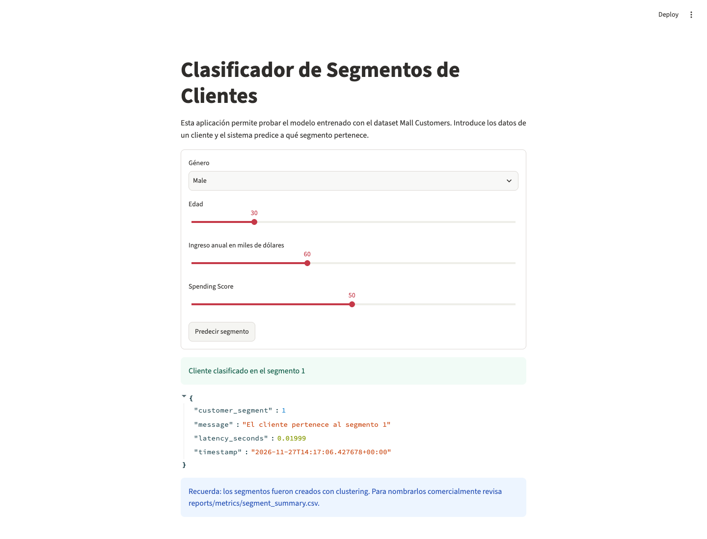
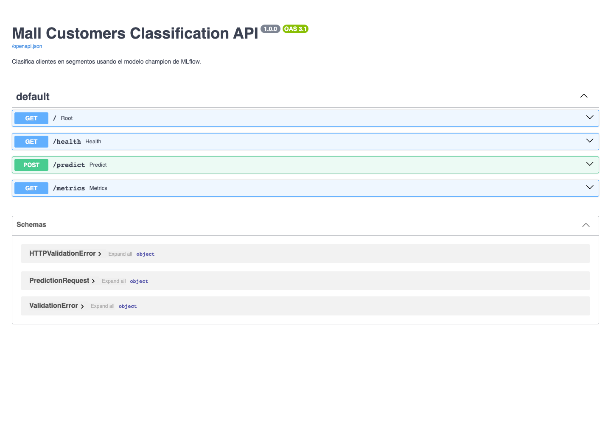
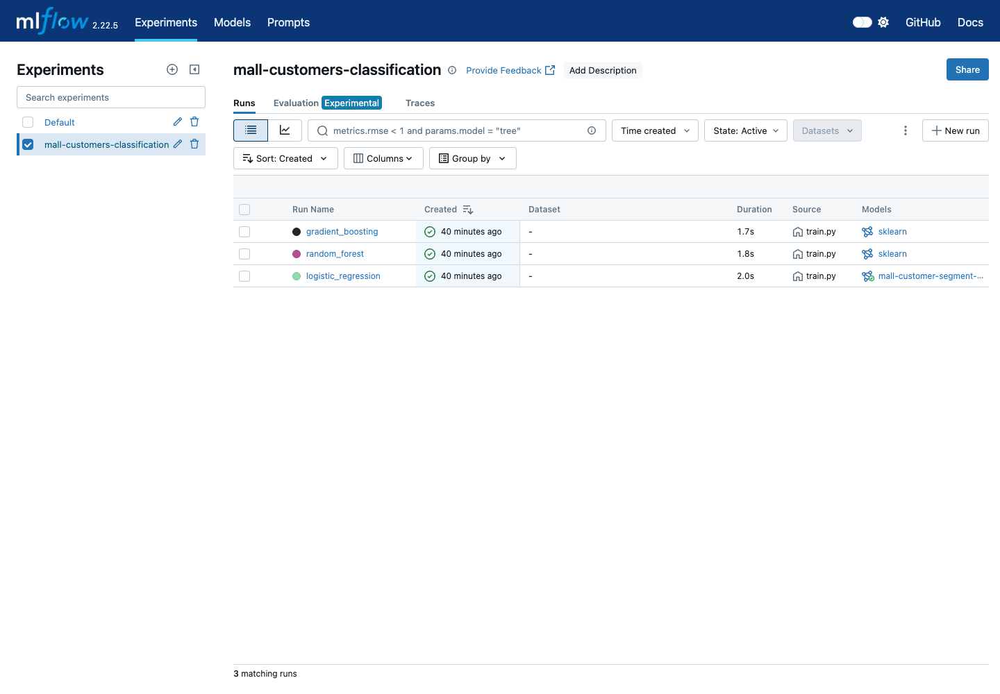
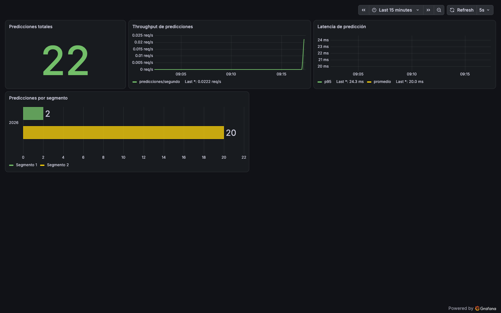
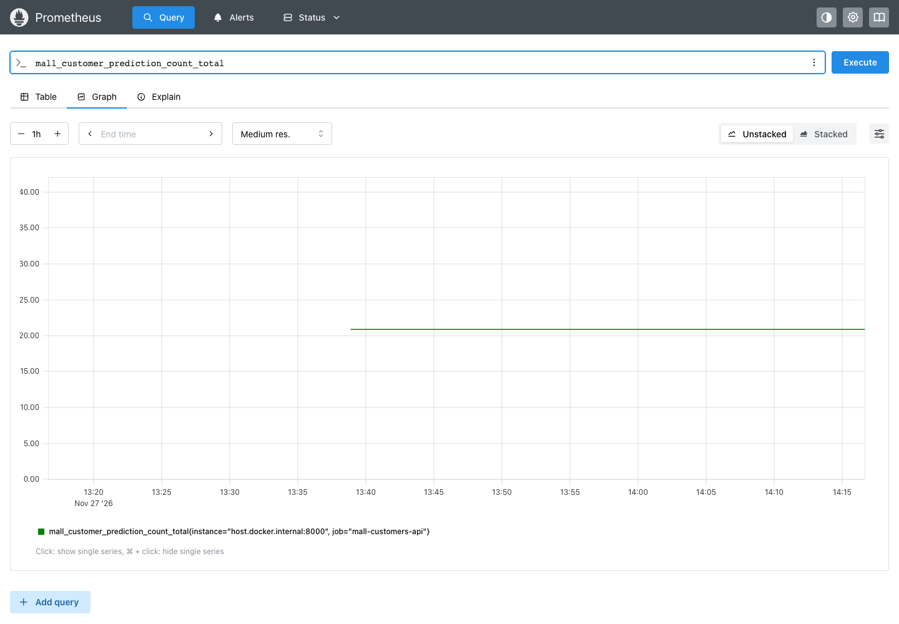

# MLOps Mall Customers 🛍️

[](https://github.com/markodavid/mlops-mall-customers/actions/workflows/ci.yml)

- **Curso:** Gestión de Proyectos en IA y CD — Universidad Autónoma de Occidente (UAO)
- **Profesor:** Juan Manuel Núñez Velasco PhD
- **Estudiantes:** Marko David García · Alejandro Meneses · Henry Rosenstihel

Proyecto MLOps de extremo a extremo: segmentación de clientes con **KMeans**, entrenamiento de clasificadores con **scikit-learn**, tracking y registro de modelos con **MLflow**, API con **FastAPI**, frontend con **Streamlit** y monitoreo con **Prometheus + Grafana**.

Basado en el tutorial *"Cómo construir un proyecto MLOps completo con Python, MLflow, FastAPI, Streamlit y Grafana"* de Juan Manuel Núñez Velasco, con ajustes de robustez (MLflow 3.x, ejecución headless en CI, API tolerante a fallos de MLflow y dashboard de Grafana aprovisionado automáticamente).

---

## ¿Qué hace el proyecto?

El dataset **Mall Customers** describe a 200 clientes de un centro comercial con cuatro variables: género, edad, ingreso anual (en miles de dólares) y *spending score* (una medida de comportamiento de compra de 1 a 100). El proyecto resuelve dos problemas conectados:

1. **Segmentación no supervisada:** descubre grupos naturales de clientes con **KMeans** (4 segmentos) y los visualiza en 2D con **PCA**. Como el dataset no trae etiquetas de negocio, los segmentos se construyen a partir del comportamiento observado.
2. **Clasificación supervisada:** usa los segmentos asignados por KMeans como etiqueta y entrena tres clasificadores (**regresión logística**, **random forest** y **gradient boosting**) para predecir el segmento de un cliente nuevo a partir de sus cuatro variables.

Alrededor del modelo se implementa el ciclo MLOps completo:

- **Tracking y registro:** cada entrenamiento queda en MLflow con métricas, matriz de confusión, reporte de clasificación y el modelo serializado; el mejor run por F1 se registra con el alias `champion`.
- **Servicio:** FastAPI carga ese modelo `champion` al iniciar y expone `/predict`, `/health` y `/metrics`. Si MLflow no está disponible, la API sigue viva y responde `503` en `/predict` con un mensaje claro.
- **Interfaz:** Streamlit permite ingresar los datos de un cliente y ver el segmento predicho sin escribir código.
- **Observabilidad:** Prometheus raspa las métricas de la API, Grafana muestra un dashboard aprovisionado y cada predicción se agrega a un CSV de monitoreo.
- **Calidad:** GitHub Actions compila el código, ejecuta el pipeline de datos y clustering, y corre la suite de pruebas en cada push o pull request.

### Flujo online

```
Analista → Streamlit → POST /predict → FastAPI → modelo champion (MLflow) → segmento
                                              ├→ métricas Prometheus
                                              └→ data/monitoring/api_predictions_log.csv
```

### Flujo offline (entrenamiento)

```
Mall_Customers.csv → limpieza → KMeans (4 segmentos) → dataset segmentado
                                                          ↓
                                  3 clasificadores sklearn → MLflow (runs)
                                                          ↓
                                   mejor F1 → Model Registry → alias champion
```

---

## Arquitectura



Diagrama generado con [Archify](https://github.com/tt-a1i/archify) a partir del código del repositorio (commit `f82e1e9`). Muestra el flujo online (Streamlit → FastAPI → MLflow), el flujo offline de entrenamiento y el monitoreo con Prometheus y Grafana.

| Componente | Puerto | Descripción |
|---|---|---|
| MLflow | 5000 | Tracking de experimentos y Model Registry |
| FastAPI | 8000 | Endpoints `/predict`, `/health`, `/metrics` |
| Streamlit | 8501 | Interfaz para probar el modelo |
| Prometheus | 9090 | Recolección de métricas |
| Grafana | 3000 | Dashboards de monitoreo |

> MLflow corre por defecto en el host (`mlflow server`); también puede levantarse en Docker con `docker compose --profile mlflow up -d`. Prometheus y Grafana viven en Docker Compose.

---

## Componentes del proyecto

El repositorio se organiza en cinco capas: **datos**, **modelado**, **servicio**, **monitoreo** y **calidad**. Cada archivo tiene una responsabilidad concreta y se apoya en los anteriores.

### Datos y features

- **`src/config.py`** — Fuente única de configuración. Carga el `.env` con `python-dotenv`, resuelve rutas absolutas (`data/`, `reports/`, `models/`) y centraliza parámetros como `RANDOM_STATE=42`, `TEST_SIZE=0.2` y `N_CLUSTERS=4`. También expone `MLFLOW_TRACKING_URI`, `EXPERIMENT_NAME`, `REGISTERED_MODEL_NAME`, `MODEL_ALIAS`, `API_URL` y `LOAD_MODEL_ON_STARTUP`. Fuerza UTF-8 en stdout/stderr para evitar errores de codificación en Windows.
- **`src/data.py`** — Extracción y transformación. `load_raw_data()` lee `data/raw/Mall_Customers.csv` y falla con un mensaje claro si no existe. `clean_column_names()` normaliza los encabezados (minúsculas, espacios a `_`, sin paréntesis). `preprocess_data()` elimina `customerid`, valida las cuatro columnas esperadas, codifica `gender` (Male=1, Female=0), elimina duplicados, convierte a `int64` y guarda `data/processed/mall_customers_processed.csv`.
- **`src/features.py`** — Define `FEATURE_COLUMNS`, el orden exacto que espera el modelo (`gender`, `age`, `annual_income_k$`, `spending_score_1_100`). Ese orden se reutiliza al entrenar, al predecir localmente y en la API, evitando desalineaciones entre entrenamiento y servicio. `get_features()` selecciona las columnas y `scale_features()` aplica `StandardScaler`.

### Modelado

- **`src/clustering.py`** — Segmentación no supervisada. Evalúa KMeans para `k=2..8` con inercia (método del codo) y silhouette, guarda ambas gráficas y entrena el modelo final con `k=4`. Añade la columna `customer_segment`, calcula una proyección 2D con PCA para visualizar los grupos y genera `segment_summary.csv`, el dataset segmentado y el scaler `models/clustering_scaler.joblib`.
- **`src/train.py`** — Entrenamiento supervisado. Carga el dataset segmentado, separa features y etiqueta (`customer_segment`) y hace un split 80/20 estratificado. Para cada modelo construye un `Pipeline` con `StandardScaler` y clasificador, entrena y calcula accuracy, precision, recall y F1 ponderados. Registra en MLflow los parámetros, las métricas, el reporte de clasificación, la matriz de confusión y el modelo serializado. Los tres algoritmos son regresión logística, random forest y gradient boosting; al final guarda `model_comparison.csv` con el ranking por F1.
- **`src/register_model.py`** — Registro del campeón. Busca el experimento en MLflow, ordena los runs por `metrics.f1 DESC`, toma el mejor, lo registra en el Model Registry y le asigna el alias `champion`. También etiqueta la versión con `source_run_id` para conservar la trazabilidad hacia el run original.
- **`src/predict.py`** — Prueba local del modelo registrado. Carga `models:/<nombre>@champion` con `mlflow.pyfunc.load_model` y predice un cliente de ejemplo. Sirve para validar el registro sin levantar la API.

### Servicio e interfaz

- **`api/main.py`** — API REST con FastAPI. Al iniciar (`lifespan`) intenta cargar el modelo `champion` desde MLflow; si falla, la API sigue viva y responde `503` en `/predict` con un mensaje claro. Expone `/` (mensaje de estado), `/health` (estado y `model_loaded`), `/predict` (valida género, edad, ingreso y spending score; codifica el género; arma el DataFrame en el orden de `FEATURE_COLUMNS`; predice; mide latencia) y `/metrics` (formato Prometheus). Cada predicción incrementa `mall_customer_prediction_count`, observa `mall_customer_prediction_latency_seconds`, etiqueta `mall_customer_segment_predictions_total{segment}` y se agrega a `data/monitoring/api_predictions_log.csv`.
- **`app/streamlit_app.py`** — Interfaz de usuario. Presenta un formulario con género, edad (18-80), ingreso anual (10-150) y spending score (1-100), envía un `POST` a `${API_URL}/predict` con timeout de 10 s y muestra el segmento, la latencia y el JSON de respuesta. También maneja errores de conexión, timeout y respuestas no JSON.

### Monitoreo

- **`docker/prometheus.yml`** — Configuración de recolección. Define el job `mall-customers-api`, la ruta `/metrics` y el target `host.docker.internal:8000`, con scrape cada 15 s y timeout de 10 s para tolerar la latencia del host.
- **`docker/grafana/provisioning/`** — Aprovisionamiento automático. `datasources/prometheus.yml` registra Prometheus como datasource por defecto (UID `prometheus`, URL `http://prometheus:9090`); `dashboards/dashboards.yml` carga los dashboards desde archivo en la carpeta **MLOps** y refresca cada 10 s.
- **`docker/grafana/dashboards/mall-customers.json`** — Dashboard **Mall Customers - MLOps** con cuatro paneles: predicciones totales, throughput (`rate(...[1m])`), latencia p95/promedio y predicciones por segmento.
- **`docker-compose.yml`** — Orquesta Prometheus (9090) y Grafana (3000) con sus volúmenes y archivos de configuración montados en solo lectura. Incluye el perfil opcional `mlflow` (5000) para ejecutar MLflow en Docker y `extra_hosts` para resolver `host.docker.internal` también en Linux.

### Calidad y automatización

- **`tests/`** — Suite de pytest. Los tests de la API usan `TestClient` y un modelo falso, por lo que validan `/health`, `/predict`, las reglas de validación, el `503` sin modelo y `/metrics` sin necesitar MLflow; los tests de datos cubren el preprocesamiento y las columnas esperadas.
- **`.github/workflows/ci.yml`** — Integración continua en GitHub Actions. En cada push a `main`/`develop` y en PRs a `main` instala dependencias con Python 3.11, verifica que `src`, `api` y `app` compilen, ejecuta `python -m src.data`, `python -m src.clustering` y `pytest -q`.
- **`requirements.txt`** — Dependencias fijadas por rango. Mantiene `mlflow<3` y `sqlalchemy<2.1` para evitar incompatibilidades del backend SQLite de MLflow 2.x.
- **`.env.example`** — Plantilla de variables de entorno (tracking URI, nombres de experimento y modelo, alias, URL de la API y carga del modelo al iniciar). El `.env` real no se versiona.
- **`pytest.ini`** — Configuración de pytest con `pythonpath` para importar `src` y `api` desde la raíz del repositorio.

### Artefactos generados

Estos directorios se crean al ejecutar el pipeline y están ignorados por Git (salvo los `.gitkeep` y el CSV original):

- `data/processed/` — datasets limpio y segmentado.
- `data/monitoring/` — log CSV de predicciones de la API.
- `models/` — scaler del clustering.
- `reports/figures/` — codo, silhouette, PCA y matrices de confusión.
- `reports/metrics/` — resumen de segmentos, reportes de clasificación y comparación de modelos.

El único dato versionado a propósito es `data/raw/Mall_Customers.csv`, porque la CI lo necesita para ejecutar el pipeline.

---

## Capturas de pantalla

### Predicción desde Streamlit

Formulario con los datos del cliente y respuesta de la API con el segmento asignado.



### API documentada con Swagger

Endpoints disponibles en `http://127.0.0.1:8000/docs`.



### Experimentos y runs en MLflow

Los tres clasificadores registrados con sus métricas y artefactos.



### Dashboard de monitoreo en Grafana

Predicciones totales, throughput, latencia p95/promedio y predicciones por segmento.



### Métricas en Prometheus

Consulta de `mall_customer_prediction_count_total` alimentada por la API.



---

## Estructura

```
mlops-mall-customers/
├── api/
│   └── main.py                  # FastAPI + métricas Prometheus + logging
├── app/
│   └── streamlit_app.py         # Frontend Streamlit
├── data/
│   ├── raw/Mall_Customers.csv   # Dataset original (versionado, lo usa CI)
│   ├── processed/               # Datos limpios y segmentados (generados)
│   └── monitoring/              # Log de predicciones (generado)
├── docker/
│   ├── prometheus.yml
│   └── grafana/                 # Provisioning + dashboard listo
├── docs/
│   ├── architecture/            # Diagrama de arquitectura (SVG)
│   └── screenshots/             # Capturas de la aplicación y el monitoreo
├── reports/
│   ├── figures/                 # Gráficas y matrices de confusión
│   └── metrics/                 # Reportes y resumen de segmentos
├── src/
│   ├── config.py                # Configuración centralizada
│   ├── data.py                  # Carga y limpieza
│   ├── features.py              # FEATURE_COLUMNS + escalado
│   ├── clustering.py            # KMeans + PCA + visualizaciones
│   ├── train.py                 # Entrenamiento + tracking en MLflow
│   ├── register_model.py        # Registro del mejor modelo (alias champion)
│   └── predict.py               # Prueba de predicción local
├── tests/                       # pytest (API + datos)
├── .github/workflows/ci.yml     # CI: compila, preprocesa, segmenta, testea
├── docker-compose.yml
├── requirements.txt
└── README.md
```

---

## Requisitos

- Python 3.11 o 3.12
- Docker Desktop (para Prometheus y Grafana)
- Git

## Puesta en marcha

### 1. Entorno virtual e instalación

```powershell
python -m venv .venv
.venv\Scripts\activate
pip install --upgrade pip
pip install -r requirements.txt
```

En macOS/Linux:

```bash
python3 -m venv .venv
source .venv/bin/activate
pip install -r requirements.txt
```

### 2. Configuración

```powershell
Copy-Item .env.example .env
```

El archivo `.env` es opcional; sin él se usan los valores por defecto de `src/config.py`.

### 3. Preprocesamiento

```powershell
python -m src.data
```

Genera `data/processed/mall_customers_processed.csv` con las columnas `gender`, `age`, `annual_income_k$`, `spending_score_1_100` (gender: Male=1, Female=0).

### 4. Segmentación con KMeans

```powershell
python -m src.clustering
```

Genera:

- `reports/figures/elbow_method.png`
- `reports/figures/silhouette_scores.png`
- `reports/figures/customer_segments_pca.png`
- `reports/metrics/segment_summary.csv`
- `data/processed/mall_customers_segmented.csv`
- `models/clustering_scaler.joblib`

### 5. Levantar MLflow

```powershell
mlflow server --host 127.0.0.1 --port 5000 --backend-store-uri sqlite:///mlflow.db --default-artifact-root ./mlartifacts
```

Abre <http://127.0.0.1:5000>. Alternativa en Docker:

```powershell
docker compose --profile mlflow up -d
```

> `requirements.txt` fija `mlflow<3` y `sqlalchemy<2.1` a propósito: MLflow 3.x usa la API de *logged models* (más lenta/inestable con un servidor local) y SQLAlchemy 2.1 rompe el backend SQLite de MLflow 2.x.

### 6. Entrenar modelos

En otra terminal con el entorno activo:

```powershell
python -m src.train
```

Se entrenan `logistic_regression`, `random_forest` y `gradient_boosting`. Cada run registra accuracy, precision, recall, F1, matriz de confusión, reporte de clasificación y el modelo.

### 7. Registrar el mejor modelo

```powershell
python -m src.register_model
```

Selecciona el run con mejor F1 y le asigna el alias `champion`.

### 8. Probar la predicción local

```powershell
python -m src.predict
```

### 9. API FastAPI

```powershell
uvicorn api.main:app --reload --host 127.0.0.1 --port 8000
```

- Swagger UI: <http://127.0.0.1:8000/docs>
- Health: <http://127.0.0.1:8000/health>
- Métricas: <http://127.0.0.1:8000/metrics>

Ejemplo de petición:

```json
{
  "gender": "Male",
  "age": 28,
  "annual_income_k": 60,
  "spending_score": 80
}
```

```powershell
curl.exe -X POST http://127.0.0.1:8000/predict `
  -H "Content-Type: application/json" `
  -d '{\"gender\":\"Male\",\"age\":28,\"annual_income_k\":60,\"spending_score\":80}'
```

Si MLflow no está disponible, `/health` sigue respondiendo (`model_loaded: false`) y `/predict` devuelve **503** con un mensaje claro.

### 10. Frontend Streamlit

```powershell
streamlit run app/streamlit_app.py
```

Abre <http://localhost:8501>.

### 11. Monitoreo con Prometheus + Grafana

```powershell
docker compose up -d
```

- Prometheus: <http://localhost:9090> → consulta `mall_customer_prediction_count_total`
- Grafana: <http://localhost:3000> → usuario `admin`, contraseña `admin`

Grafana ya trae el datasource de Prometheus y el dashboard **Mall Customers - MLOps** aprovisionados (`docker/grafana/`). Genera tráfico desde Streamlit o con:

```powershell
1..20 | ForEach-Object {
  Invoke-RestMethod -Method Post -Uri http://127.0.0.1:8000/predict `
    -ContentType "application/json" `
    -Body '{"gender":"Female","age":35,"annual_income_k":70,"spending_score":65}'
}
```

Paneles incluidos:

- Predicciones totales
- Throughput (`rate(...[1m])`)
- Latencia p95 y promedio
- Predicciones por segmento

> **Linux**: `docker/prometheus.yml` usa `host.docker.internal`; el `extra_hosts` de `docker-compose.yml` lo resuelve también ahí.

## Tests

```powershell
pytest -q
```

Los tests de la API usan un modelo falso, así que **no necesitan MLflow** ni el modelo registrado.

## CI con GitHub Actions

El workflow `.github/workflows/ci.yml` se ejecuta en cada push a `main`/`develop` y en PRs a `main`:

1. Instala dependencias
2. Verifica que `src`, `api` y `app` compilen
3. Ejecuta preprocesamiento y clustering
4. Corre `pytest`

El dataset `data/raw/Mall_Customers.csv` está versionado a propósito: CI lo necesita.

## Subir a GitHub

```powershell
git init
git add .
git commit -m "feat: proyecto MLOps completo con MLflow, FastAPI, Streamlit y Grafana"
git branch -M main
git remote add origin https://github.com/markodavid/mlops-mall-customers.git
git push -u origin main
```

## Notas sobre los segmentos

Los segmentos los crea KMeans y su numeración puede variar si cambias `RANDOM_STATE` o `N_CLUSTERS`. Las etiquetas comerciales del tutorial son orientativas:

| Segmento | Etiqueta sugerida |
|---|---|
| 0 | Cliente premium |
| 1 | Cliente conservador |
| 2 | Cliente joven con alto gasto |
| 3 | Cliente de bajo valor |

Revisa siempre `reports/metrics/segment_summary.csv` para asignar los nombres según los promedios reales de edad, ingreso y spending score.

## Solución de problemas

| Problema | Solución |
|---|---|
| `FileNotFoundError: Mall_Customers.csv` | Coloca el CSV en `data/raw/` con ese nombre exacto |
| `MlflowException: API request ... failed` | Levanta `mlflow server` en el puerto 5000 o revisa `MLFLOW_TRACKING_URI` |
| `ImportError: cannot import name 'FallbackAsyncAdaptedQueuePool'` | Usa `sqlalchemy<2.1` (ya está fijado en `requirements.txt`) |
| `UnicodeEncodeError: 'charmap' codec ...` al cerrar un run | `src/config.py` fuerza UTF-8; si persiste, ejecuta con `$env:PYTHONIOENCODING="utf-8"` |
| `/predict` responde 503 | El modelo no se cargó: verifica MLflow y ejecuta `python -m src.register_model` |
| Prometheus no ve la API | La API debe correr en el puerto 8000 del host y Prometheus tener `host.docker.internal` resuelto |
| `docker compose` falla con `dockerDesktopLinuxEngine` | Abre Docker Desktop y espera a que el motor esté en ejecución |
| Grafana sin datos | Espera ~15 s (scrape cada 15 s) y genera predicciones |
| El primer arranque de Grafana tarda varios minutos | Es normal en el primer inicio: registra sus plugins. Verifica `http://localhost:3000/api/health` hasta que responda `database: ok` |
| Streamlit no conecta | Revisa que FastAPI esté en `http://127.0.0.1:8000` o ajusta `API_URL` |

## Nota sobre las métricas del clasificador

Los modelos alcanzan F1 ≈ 1.0 porque las etiquetas (`customer_segment`) las genera KMeans con las mismas features: el clasificador aprende una frontera que casi reproduce al clustering. Sirve para demostrar el flujo MLOps, pero **no mide rendimiento contra una verdad de negocio**. Para un caso real necesitarías etiquetas humanas (por ejemplo, segmentos definidos por marketing).

## Checklist de verificación

- [ ] `python -m src.data` genera `data/processed/mall_customers_processed.csv`
- [ ] `python -m src.clustering` genera figuras, resumen y dataset segmentado
- [ ] MLflow muestra 3 runs con métricas, matriz de confusión y modelo
- [ ] `python -m src.register_model` deja la versión 1 con alias `champion`
- [ ] `python -m src.predict` imprime un segmento
- [ ] `GET /health` devuelve `model_loaded: true`
- [ ] `POST /predict` devuelve `customer_segment`
- [ ] `GET /metrics` expone `mall_customer_prediction_count_total`
- [ ] `pytest -q` pasa
- [ ] Grafana muestra el dashboard con datos tras generar predicciones
